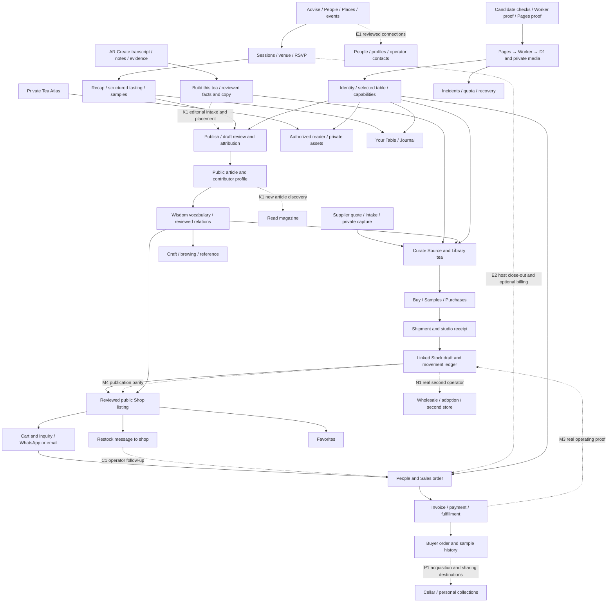

# Teajia working plan

**Baseline · 17 November 2026** · Source inspection started at `4f884507` with local edits present. The coordinated release receipt proves frontend build `1m0md3pmvx` and Worker revision `94dc1a5e`, runtime `c9e603c9-2d59-45c3-9d4e-c35b9b24eed5`. Public version endpoints matched the receipt. [Exact release run](https://github.com/storyoftheleaf/teajia/actions/runs/44022566874)

[System map](#system-map) · [Where work lives](#where-work-lives) · [Delivery queue](#delivery-queue) · [Ready to ship](#ready-to-ship) · [Maintaining this document](#maintaining-this-document)

Open the [interactive flowchart](planning/blueprint/flowchart.html) to trace handoffs and identify gaps. The [whole-site delivery register](planning/blueprint/DELIVERY.md) records work, decisions and closure evidence. For a fresh orchestration session, start with the [controller handoff](planning/blueprint/CONTROLLER.md). The [blueprint](planning/blueprint/README.md) links the supporting evidence.

## Purpose and current outcome

Teajia is Adrian’s working tea system for buying, keeping stock, selling, hosting and preserving what he learns. It should carry preparation and recordkeeping so people can attend to the tea and one another. Read carries approved writing, Craft teaches tea, Advise connects people to human guidance and hosting, and Shop turns curated stock into a personal inquiry. Once this works for Adrian’s shop, a second operator and a few real collaborators can prove the shared network. [Vision](docs/VISION.md) · [Adrian’s North Star](../home-repo/NORTH-STAR.md)

**Current priority** · Follow one tea on a phone from a supplier’s quote and photo through Library, purchase, partial arrival and its existing private Stock draft. Preserve the supplier and tea identity, show the remaining balance, and prove that retrying a lost response adds stock once. Carry that same tea into the first operator’s sale, invoice, payment, shipment and buyer view. The approved base is current Curate and its supplier-grouped Library. Keep their compact card and one-tap actions. [Manage outcome](todo/plans/manage-rebuild.md#current-outcome) · [November 16 decisions](todo/plans/manage-rebuild-decisions.md)

Keep WhatsApp/email conversation and human curation central. Journal, Favorites and Cellar have distinct purposes. Ordinary sessions leave room for tea, with recorded participation available for an explicitly structured tasting. Public navigation, visible Manage redesigns, private-source publication, real-data corrections and production releases follow the existing owner decisions and approvals.

| Stage | What a person should be able to do |
|---|---|
| Adrian’s working shop | Source in the field, know what is physically on hand and what is still due, and carry an order through payment and delivery from the same records. See M1–M5. |
| Public practice | Find an approved story or guide, follow the relevant tea or person, ask for an order or visit, and keep their own tea memory afterward. A contributor or host can give material to an editor for review. See K1–K4, E1–E2 and P1. |
| Shared tools and sourcing | A Tea Master can participate with the access they need. A second operator can open a local shop, buy through the network and run their own stock, sessions and sales with scoped staff access. See N1. |

The [Vision](docs/VISION.md) also holds longer-horizon ideas such as printable education, deeper training, shared sourcing intelligence and support for tea-producing land. Give each a concrete audience and approved outcome before moving it into active delivery. The proposed inventory image-grading template is exploratory.

## System map

Solid arrows show implemented handoffs with source or fixture evidence. Dotted arrows mark an incomplete connection, an unresolved decision, or a handoff still needing real-use proof. Some journeys share the same record without advancing through every optional step.

## Where work lives

Read the route definitions and server guards as the current contract. Public routes live in [App.tsx](src/App.tsx), Manage routes in [AdminApp.tsx](src/admin/AdminApp.tsx), room visibility in [manageNav.ts](src/components/manageNav.ts) and [navigationConnections.ts](src/components/navigationConnections.ts), browser requests in [api.ts](src/lib/api.ts), and API routing and permissions in the [Worker entry](worker/src/index.ts). Route aliases, token links, role-gated doors and preview routes are part of those maps.

| Journey | Entry and authoritative records | Current state and next check |
|---|---|---|
| Home and public navigation | `/`, `/read`, `/craft`, `/advise`, `/shop`; desktop rail and phone bar share the four product sections. Directory, event, store and token links have their own routes. | Established entry points. Verify compact phone and desktop navigation, cold links and fallback states on a release affecting these surfaces. [Layout](docs/claude/layout.md) |
| Curate and Samples | `/admin/compass` → Source and Library → Buy or Samples. Compass entry + supplier + quote preserve identity. Notes, recordings and source files stay private. Structured imports, manual capture, corrections and undo share this surface. | Functional route and locally recorded purchase/receipt evidence. Current Curate is the working room. `/admin/compass/v2` and classic form are retained references. [Manage](todo/plans/manage-rebuild.md) · [Curate contract](docs/CURATE_CONSUMER_CONTRACT.md) |
| Purchasing and logistics | `/admin/purchase-orders` and Curate order history → vendor/hub → consignment → studio receipt → linked inventory. Direct delivery and staged logistics have different steps. | Partial receipt is implemented. Run M1 and reconcile older unmatched purchase/parcel evidence before any repairs. [Purchase logistics](docs/PURCHASE_LOGISTICS.md) |
| Stock and catalog | `/admin/stock`, `/admin/capture`, `/admin/intake`, `/admin/catalog`; product, stock movement, draft/personal/sample purposes, collection and listing state. | Counts and visibility have separate rules. Preserve dense browsing, the scroll chain and one movement per arrival. Cost retains currency and distinguishes blank from zero. Freight settings and historical freight allocation require separate evidence. [Money](docs/claude/money.md) · [Layout](docs/claude/layout.md) |
| Shop and retail | `/shop`, `/shop/product/:id`, `/store/:slug`, cart, order inquiry, public archive/restock, `/order/:ref`, `/account/orders`. Public projections depend on listing, stock state, tenant and safe fields. | Website submission saves a scoped request and draft invoice before optional WhatsApp contact. Sold-out pages keep their address and compose a restock message to the owning shop. Prove correct Sales intake, invoice, payment, stock movement and buyer outcome. Teaware and Sets need a catalog/content decision before exposure. [Daily workflows](docs/STORE_OPERATOR_DAILY_WORKFLOWS.md) · [WhatsApp setup](docs/WHATSAPP_ORDER_SETUP.md) |
| Sales, People and Today | `/admin/activity`, `/admin/people`, `/admin/dashboard`; inquiry, contact/customer, invoice/payment, shipping and fulfillment, account signals. | Daily operating tools are present. The room-by-room audit records navigation, action visibility and readiness issues. Use the actual sale to prioritize which block the operator. [Sales decisions](todo/plans/manage-rebuild-decisions.md) · [Operator procedure](docs/STORE_OPERATOR_DAILY_WORKFLOWS.md) |
| Read and Publish | `/read`, `/article/:slug`, curated story routes, `/admin/magazine`, contributors, collections and guest notes. Curated Read routes use release-controlled assets and publish state. D1 articles use the article publication path. | Both publishing paths exist. `/read` currently discards its fetched D1 publication list. Establish a reviewed editorial placement path and resolve legacy reading memory. [Read index](src/pages/read/ReadIndex.tsx) · [Contributor editing](docs/CONTRIBUTOR_EDITOR.md) |
| Tea record and AR Create | Curate tea → Build this tea → reviewed private notes, recordings and AR passages → explicitly accepted facts or wording. AR Create owns source originals and review copies stay scoped. | Connector and receiving contract exist. Runtime pairing, AR Create reader action and the exact end-to-end deployment require evidence. Article intake is a separate editorial handoff. [Tea record](docs/TEA_RECORD_CONNECTIONS.md) · [Transcript-first contract](docs/AR_CREATE_TEA_LINK_CONTRACT.md) |
| Craft, Wisdom and Atlas | `/craft` (`/learn` alias), `/wisdom` and its entities, `/admin/wisdom`, private `/atlas/*`. Shared vocabulary and reference manifests, typed Wisdom relationships and publication state, licensed Atlas R2 package. | Core relationships and private archive access are implemented. Audit weak or missing links with a representative reviewed tea, cultivar and article. Atlas ability is separate from store ownership and product/public content. [Wisdom](docs/TEA_WISDOM_BASE.md) · [Atlas](docs/TEA_ATLAS.md) |
| Advise, public people and places | `/advise`, `/people`, `/people/:slug`, `/spaces`, `/find-a-table`, `/event/:slug`; Tea Master profiles and approved storefront selection can connect public surfaces. | Live revision includes the Advise public upcoming-event feed. Private supplier/contact records and public profiles have different visibility. Directory shape and routing are owner decisions. [Connections plan](todo/plans/connections-page.md) · [Pay and sign-in](docs/claude/pay-and-sign-in.md) |
| Sessions and tastings | `/events` and event/recap routes, `/admin/events`, `/admin/tasting-events`, `/admin/venues`, invitation and guest session links. Events, recipients, tea menu, tasting sessions and notes feed follow-up and reviewed publishing. | Ordinary hosting and structured tasting coexist. Run a host/guest walkthrough from invitation and RSVP to recap, private Journal or approved publication. [Event design](docs/plan/event-system-v2.md) · [Tasting decisions](todo/plans/manage-rebuild-decisions.md) |
| Your Table and identity | `/account`, `/account/journal`, `/collection`, `/account/cellar`, account order/sample history, settings and token claims. Password/OTP/Google and selected membership control account access. | Journal, Favorites, Cellar and private collections are distinct. Verify claim and tasting destinations, guest-to-member continuity and account switching. [Members and access](docs/MEMBERS_AND_ACCESS_GUIDE.md) · [Authorization tests](src/admin/AdminApp.access.test.ts) |
| Network and second shop | `/admin/network` catalog, listings and adoption; `/admin/activity?tab=wholesale`; tenant-held stock and orders with bilateral records. | Core network mechanisms exist. Real operator onboarding and two-account receiving, invoices, isolation and visibility are open validation. [Multi-store](docs/MULTI_STORE_PLAN.md) · [Australia playbook](docs/AUSTRALIA_LAUNCH_PLAYBOOK.md) |
| Agents and platform | `/mcp`, `/mcp/public`, admin tokens, browser API, D1 account records, R2 media, scheduled rates/cleanup, AI provider limits, incident ledger and `/account/fixes`. | Writes use scoped credentials and preview/confirmation tickets. A failed provider or request must preserve the underlying record and leave an actionable trace. [MCP](docs/claude/mcp.md) · [Architecture](docs/ARCHITECTURE.md) · [Site problems](docs/claude/site-problems.md) |

## Delivery queue

Run two bounded journeys. For operations, restore the source CI gate, prove physical receipt in M1, and enforce first-publication policy in M4 before the controlled public sale in M3. Link the account, encounter, product, receipt, movement, invoice/payment and buyer records through their existing identifiers and ownership. For editorial, prove the two-revision K1 lifecycle with synthetic material before selecting a real keeper. Record operator, editorial and deployment acceptance in [Launch Validation](docs/LAUNCH_VALIDATION.md). [Independent review and delivery order](planning/blueprint/review.md#dependency-adjudication-and-smallest-demonstrable-delivery)

| ID | Gap and next action | Done when |
|---|---|---|
| **M1 · Now** | **Phone capture → partial arrival → Stock.** Local evidence covers a 250 g order, 100 g received after an injected lost response, 150 g due, and 100 g in the same private draft. The local microphone recovery exercise used synthetic input. Production `94dc1a5e` includes the receipt regression coverage and the microphone recovery changes. [Manage evidence](todo/plans/manage-rebuild.md#start-here-state-when-the-first-session-closed-2026-11-12) · [Exact release](https://github.com/storyoftheleaf/teajia/actions/runs/44022566874) | Repeat on the intended candidate and actual phone with a fresh tea, saved supplier/quote/photo/note, one committed receipt after retry, a visible balance in Library/Purchases and the same private Stock link. Verify real-provider recording and retry on that phone. |
| **M2 · Now** | **Older purchase and freight handoffs.** Find unmatched legacy receipts, uncertain quantities, missing invoice weights and old-address parcels with read-only evidence. Keep goods costs, cost allocation and shelf freight separate. [Purchase logistics](docs/PURCHASE_LOGISTICS.md) · [Curate data review](docs/LAUNCH_VALIDATION.md#curate-inventory-data-review) | Each proposed correction names the source evidence and affected records. Partial quantities and unknowns stay truthful. Any write or rate change follows its existing review decision and receives a ledger check. |
| **M3 · Now** | **First-operator sale.** Prove Source → Stock → public eligibility → inquiry → Sales → invoice → payment → fulfillment → buyer view. Review existing invoice repair only against the read-only business-data preview. [Launch validation](docs/LAUNCH_VALIDATION.md#a-launch-required-validation) | Shop and operator agree on product, unit, price, currency and remaining quantity. Correct payment and movement survive retry. Buyer sees the appropriate order state on the correct identity. Check cancellation, partial payment and refund in a controlled fixture. Record real operating evidence. |
| **M4 · Now** | **Stock publication eligibility.** Adrian approved name, type, selling price and counted stock for first publication. The Stock UI classifies readiness, while separate Worker visibility actions guard incoming-only stock. Compare browser, API and MCP paths with the approved rule and existing listings. [November 16 decisions](todo/plans/manage-rebuild-decisions.md) · [Publication rules](src/lib/productPublication.ts) · [Worker](worker/src/index.ts) | All allowed write paths follow the agreed first-publication rules, keep private/incoming stock out of Shop, preserve legitimately sold-out URLs and give accurate batch results. |
| **M5 · Next** | **Record links and phone Stock.** The link guard allows unfinished links from Sales to filtered Sessions, from Sold Items to filtered Tea Glossary, and from Sample to its Curate record. Verify supplier grouping and scroll return before tackling suggested recount, QR and offline additions. [Link guard](src/admin/guards/adminLinkReaders.test.ts) · [Phone Stock plan](todo/plans/stock-phone-by-supplier.md) | Each visible record link arrives at the correct record or filter, with allowed and denied account cases. Supplier/scroll context survives return. Stage additional field tools from an observed operator need. |
| **C1 · Next** | **Shop restock and listing lifecycle.** Verify the sold-out page and contact option as a guest. Confirm who handles the manual WhatsApp/email restock message and how follow-up works when stock returns. [Product page](src/pages/ProductPage.tsx) · [Restock browser coverage](tests/sold-out-restock.spec.ts) | The public link survives sellout, the composed message names the correct tea and owning shop, and the operator has an agreed follow-up. |
| **K1 · Next** | **Approved edition → draft → editor → public issue.** The existing Wordforge draft handoff has renderer, edit and revision gaps. Before extending it, distinguish source family, stable output identity, exact revision, stable public URL and deliberate issue slot. Apply the same revision-bound approval rule across REST, MCP and placement. Sync revisions atomically and validate contributor, media and credit scope. [Editorial evidence](planning/blueprint/editorial.md) · [Review findings](planning/blueprint/review.md) | Publish synthetic revision A into an issue. Sync B and keep A live. A stale confirmation refuses safely. B becomes visible after explicit review. Verify renderer, byline, retry, two outputs from one source, wrong-account placement, and withdrawal separately for issue, route, API, module, metadata and media. Then select a real keeper. |
| **K2 · Next** | **Reading memory and editorial owner tools.** Trace `READER`, the live `STORY_VIEW` save consumer, legacy local saves, and owner/cold-load differences. The existing track proposes retiring unused memory. Confirm affected affordances and settle the intended live behavior first. [Read integrity detail](docs/tracks/01-launch-integrity.md) · [App](src/App.tsx) | Every visible Read action has a real destination or is removed deliberately. Signed-out and cold owner sessions behave consistently. Routes to unpublished work stay gated. |
| **K3 · Next** | **Evidence → tea identity → public knowledge.** Prove AR pairing and approved excerpt reuse. Trace the encounter link, Stock holding and public product projection to an eligible Wisdom and Craft or Read reference. Use existing integrity findings to identify unresolved relations, duplicate vocabulary and data that still needs authorship review. [Tea record](docs/TEA_RECORD_CONNECTIONS.md) · [Consumer identities](docs/CURATE_CONSUMER_CONTRACT.md) · [Wisdom](docs/TEA_WISDOM_BASE.md) | A sourced tea stays traceable through each intended surface and separate ownership and quantities are accurate. An ambiguous or hidden relation stays private. Refreshing a source cannot publish copy. Private Atlas stays scoped. |
| **K4 · Next** | **Craft guide placement.** The Craft index names tea types that still lack usable guide destinations. Choose the first guides from the existing brewing brief and identify their reviewed tea, article and Wisdom links. [Craft index](src/pages/craft/CraftIndex.tsx) · [Brewing brief](todo/plans/brewing-guides.md) | A reader can start in Craft, follow an approved brewing guide and find its related reference or tea. Coming-soon and unavailable material are explicit. |
| **E1 · Next** | **Public connections and event follow-through.** Establish which approved public profiles, venues and guidance belong together. Decide directory placement before navigation work. Verify the released Advise → public event path and Sessions → guest follow-up. [Connections](todo/plans/connections-page.md) · [Tasting decisions](todo/plans/manage-rebuild-decisions.md) | A visitor reaches a real approved profile, event or contact option. A guest can RSVP, return to the recap and save the intended private memory. Private contacts and payment details stay scoped. |
| **E2 · Next** | **Close a session.** Host UI closes RSVPs. The older completion endpoint has no mounted caller, writes a different status field from the newer lifecycle and can draft zero-priced invoice lines using attendee display names to match prior work. Reconcile host lifecycle and the approved free/paid policy before connecting billing. [Host UI](src/admin/components/EventDetail.tsx) · [Worker](worker/src/index.ts) | Closing RSVPs and completing the session are distinct. An ordinary and a structured tasting reach intended follow-up. If billing is chosen, identical display names and retry keep one correct draft per eligible attendee and create no unintended sale or movement. |
| **P1 · Next** | **Personal records and share claims.** Trace existing Compass/Journal writes from share claims and explicit Cellar additions. Verify account switching and personal identity discovery before changing labels or destinations. [Share claim page](src/pages/ShareCardPage.tsx) · [Curate consumer contract](docs/CURATE_CONSUMER_CONTRACT.md) | Repeat a claim and re-sign-in across devices. One record is created in the approved destination, confirmation leads back to it, and Journal, Favorites, Cellar and the Curate operator record retain their intended boundaries. |
| **R1 · Release gate** | **Production trust and recovery.** Compare UI/server grants for member/table shares and operator Curate. Verify OTP and Google return, private media, real editorial access, older deployment-host policy, account revocation, incident visibility, service-worker retirement and stale-build recovery. Capture actual phone, mainland and recovery evidence in the existing checklist. [Testing](docs/claude/testing.md) · [Launch validation](docs/LAUNCH_VALIDATION.md) | Candidate fixtures cover permitted and denied cases. Real services and boundaries have deployed evidence, and old sessions recover to current assets. Restore proof exists for affected data. Private working material stays outside browser-bundled manuals, which currently use a client-side UI gate. |
| **R2 · Verified locally** | **Stock browser regression.** Earlier general CI stopped at 18 expected versus 19 rendered options after the owner’s Drafts view was added. `043c68c3` updated the assertion, and the full supplier-sheet scenario passed in Desktop and Mobile Chrome on `94dc1a5e`. [Earlier failed run](https://github.com/storyoftheleaf/teajia/actions/runs/44015861979) · [General CI for this revision](https://github.com/storyoftheleaf/teajia/actions/runs/44023062406) | Both browser projects reach filtering, reassignment and viewport checks. The focused run covers those steps. The linked CI records the wider suite. |
| **R3 · Release gate** | **Restore the general source CI gate.** The checks job on `94dc1a5e` failed because `src/components/TeaCompass/index.tsx` reached 1,846 lines against a 1,843-line allowance. The exact live release receipt is separate evidence. [Failed source test step](https://github.com/storyoftheleaf/teajia/actions/runs/44023062406/job/133841325571) | A scoped change preserves the existing Source and voice/retry behavior. The drift and relevant source checks pass under the existing ceiling, followed by the candidate checks. |
| **N1 · After first operator** | **Second store and wholesale.** Validate Jesse’s onboarding and deliberate storefront visibility, then complete one real two-account order and receipt. The Tea Master invite currently also creates a private hosted account. Evaluate the approved person-first option as a separate identity/onboarding change. [Australia playbook](docs/AUSTRALIA_LAUNCH_PLAYBOOK.md) · [Tea Master onboarding](todo/plans/tea-master-onboarding.md) | Both operators see the proper timeline, bilateral invoices and correct owned stock, including a retry and denied cross-account access. An invited identity gets only the intended membership and hosted-shop access. |

## Ready to ship

The 17 November audit opened 12 signed-out production routes at 390 and 1440 px. Exact-revision local browser fixtures for the Stock supplier sheet, partial-arrival retry and Source Notes voice recovery passed 14 scenarios with two device-specific skips. Those cover the tested states and mocked boundaries. The actual phone, real provider and paid order remain open under M1 and M3.

For a change, record the intended behavior and exact candidate. Walk the affected journey through the real entry point using a matching local sandbox, with the applicable desktop and phone states. Use the [test contract](docs/claude/testing.md) for type/build, focused frontend and Worker tests, mobile and browser checks. Cover retry, partial completion, old records, account changes and private/public visibility wherever the journey crosses those boundaries. Use the existing data migration preview and owner decision where required. A Manage appearance or navigation decision uses the approved before/after process.

After an authorized ship request, use the [release procedure](docs/claude/deploy-and-secrets.md#ship-command--mandatory). A coordinated API and Pages release uses an immutable candidate tag, Worker dry run and exact runtime proof, then a serialized publication of the same revision to `teajiafinal`. Verify the durable runner has persisted its revision and resumption path before yielding. Shipment requires `release-result` state `live` with the build ID and exact public bytes. [Release evidence and recovery](docs/VERIFIED_RELEASES.md)

The broader first-operator launch remains open until the required real-business, identity, editorial and environment checks in [Launch Validation](docs/LAUNCH_VALIDATION.md) have evidence. A scoped release can ship before that broader acceptance.

## Maintaining this document

- Update the [delivery register](planning/blueprint/DELIVERY.md) when a handoff changes. Update this summary and the map when their routing or sequence changes. Put externally exercised launch evidence in [Launch Validation](docs/LAUNCH_VALIDATION.md) and shipped history in [Changelog](docs/CHANGELOG.md).
- Use [Vision](docs/VISION.md) for long-term product direction, [Pillar](docs/PILLAR.md) for product invariants, [Design System](docs/DESIGN_SYSTEM.md) for UI rules, and the [documentation index](docs/INDEX.md) for specialist contracts. Keep detailed decisions, operator steps and test recipes where they are used.
- Treat earlier roadmap, snapshots, audits and tracks as source history or supporting detail. This page summarizes priorities. The delivery register holds detailed work and decisions. Route, authorization, data and release claims should point to code, a test result, a deployed observation or durable evidence.
